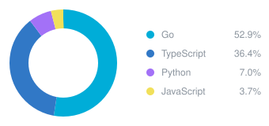

<h1 align="center">Hi there 👋</h1>

  
  &emsp;&emsp;
  

 

  <picture>
    <source media="(prefers-color-scheme: dark)" srcset="https://raw.githubusercontent.com/sawada-naoya/sawada-naoya/output/github-snake-dark.svg" />
    <source media="(prefers-color-scheme: light)" srcset="https://raw.githubusercontent.com/sawada-naoya/sawada-naoya/output/github-snake.svg" />
    
  </picture>

